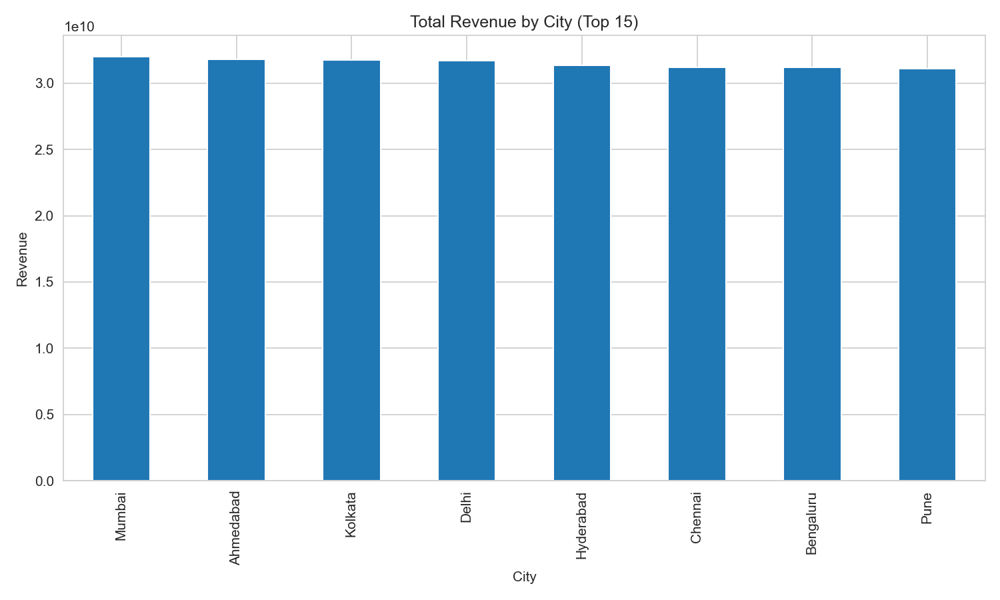
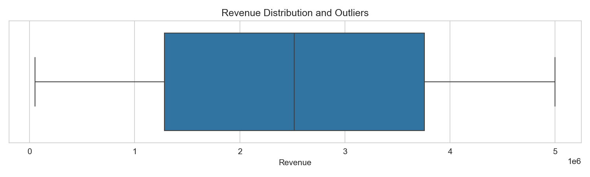
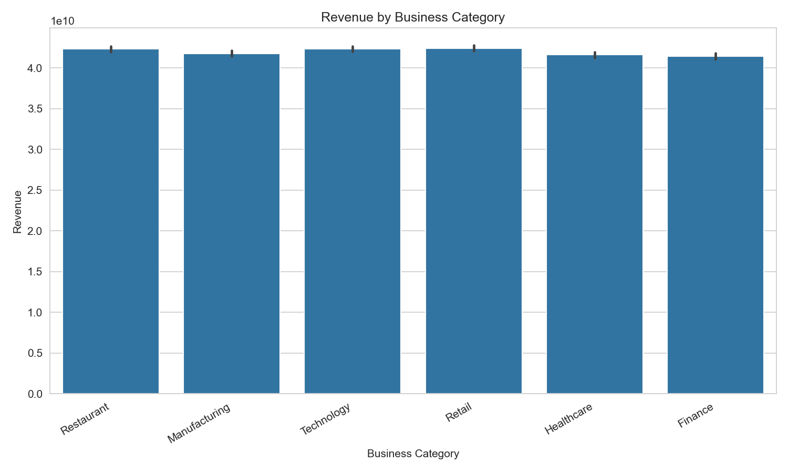

# AI-Powered EDA Report

**Rows:** 100000  
**Columns:** 7

## Key Business Insights

### Top 5 Cities by Revenue

| city      |     revenue |
|:----------|------------:|
| Mumbai    | 3.20044e+10 |
| Ahmedabad | 3.18098e+10 |
| Kolkata   | 3.1755e+10  |
| Delhi     | 3.16755e+10 |
| Hyderabad | 3.13247e+10 |

### Revenue by Business Category

| category      |     revenue |
|:--------------|------------:|
| Retail        | 4.24307e+10 |
| Restaurant    | 4.23528e+10 |
| Technology    | 4.23454e+10 |
| Manufacturing | 4.18033e+10 |
| Healthcare    | 4.16287e+10 |
| Finance       | 4.14655e+10 |

### Average Rating by Category

| category      |   rating |
|:--------------|---------:|
| Manufacturing |  3.76346 |
| Finance       |  3.75364 |
| Retail        |  3.7509  |
| Technology    |  3.7493  |
| Restaurant    |  3.74338 |
| Healthcare    |  3.7425  |

**Total Revenue:** 252026324002.08

**Average Revenue:** 2520263.24

## Visualisations

